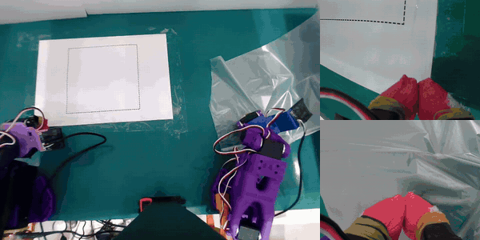
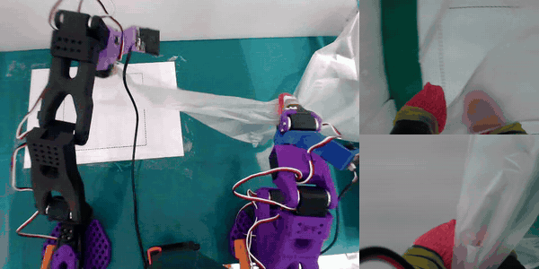
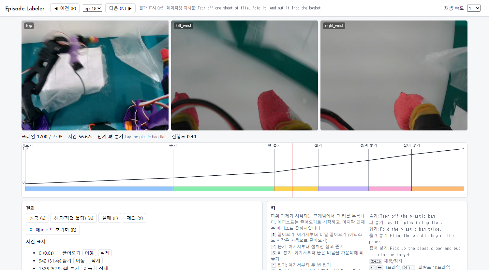

# PAC 2026 비닐 접기 VLA (SO-101)



*대회 현장에서 녹화한 시연 한 에피소드(`pac_full_task` 4번, 6배속). 왼쪽은 상단 카메라, 오른쪽 위는 왼팔 손목, 오른쪽 아래는 오른팔 손목 카메라입니다.*

Physical AI Challenge 2026에서 SO-101 양팔 로봇으로 비닐봉지를 뜯어 접는 과제를 푼 기록입니다. 직접 수집한 시연·개입 데이터셋, 그 데이터를 모으고 다듬으려고 만든 도구, SmolVLA 파인튜닝과 SARM 학습 기록을 담았습니다.

- 로봇: SO-101 양팔(`bi_so_follower`), 관절 12개, 카메라 3대(`top`, `left_wrist`, `right_wrist`)
- 모델: SmolVLA 파인튜닝, SARM(진행도 보상 모델)
- 환경: LeRobot 0.6.1 (노트북 conda 환경 `lerobot312`, GPU 서버 `lerobot061`)
- 데이터셋: Hugging Face [kangkb7701](https://huggingface.co/kangkb7701)에 전체 공개

## 과제

롤에서 비닐봉지 한 장을 뜯어 가운데에 펴 놓고, 두 번 접어 A4 용지 위로 옮긴 뒤, 다시 집어 목표에 넣습니다. 시연 한 번은 평균 약 78초이고(대기 구간을 포함한 원본 기준), 아래 여섯 단계로 나눠 라벨링했습니다.

1. 끌어오기 `Pull out the plastic bag.`
2. 뜯기 `Tear off the plastic bag.`
3. 펴 놓기 `Lay the plastic bag flat.`
4. 접기 `Fold the plastic bag twice.`
5. 옮겨 놓기 `Place the plastic bag on the paper.`
6. 집어 넣기 `Pick up the plastic bag and put it into the target.`

대회 전 리허설은 한 팔로 투명 비닐을 반 접는 과제로 했습니다.

## 데이터셋

모두 직접 수집했고 LeRobot v3.0 형식, 30fps, 640×480입니다. 영상을 포함한 전체는 Hugging Face에 있습니다.

| 데이터셋 | 내용 | 규모 |
|---|---|---|
| [pac_full_task](https://huggingface.co/datasets/kangkb7701/pac_full_task) | 대회 현장(2026-10-09~10) 양팔 전체 과제 시연 원본 | 51 에피소드, 119,835프레임 |
| [pac_full_task_hil](https://huggingface.co/datasets/kangkb7701/pac_full_task_hil) | 양팔 전체 과제에서 사람이 넘겨받아 교정한 구간만 녹화한 개입 데이터 | 30 에피소드, 55,347프레임 |
| [fold_film_onearm_hil](https://huggingface.co/datasets/kangkb7701/fold_film_onearm_hil) | 리허설(2026-10-07) 한 팔 반 접기의 개입 데이터. 0~9번은 개입 없는 기준 실행(성공 2/10) | 53 에피소드, 26,311프레임 |

```python
from lerobot.datasets import LeRobotDataset
ds = LeRobotDataset("kangkb7701/pac_full_task")
```

폴더째 받으려면 `hf download kangkb7701/<이름> --repo-type dataset --local-dir <폴더>`를 씁니다.



*개입 데이터 한 에피소드(`pac_full_task_hil` 1번, 4배속). 정책이 실패할 것 같을 때 사람이 리더암으로 넘겨받아 교정한 구간만 들어 있습니다.*

- 개입 데이터에서 교정 구간의 경계와 성공 여부는 각 데이터셋의 `hil_labels.json`에 있습니다.
- `fold_film_onearm_hil`은 한 팔 시연 데이터(`fold_film_onearm_demo`, 50 에피소드)와 항목이 같아 그대로 합칠 수 있습니다. 시연 데이터는 공개하지 않았습니다.
- 사람이 붙인 단계 라벨은 이 저장소의 `labels/`에 있습니다.
    - `labels/pac_full_task51_trimmed/human_labels.json`: 51개 에피소드 통합 라벨. 앞뒤 대기 구간을 자른 데이터 기준 프레임입니다.
    - `labels/pac_full_task_trimmed/`: 먼저 라벨링한 18개 에피소드의 라벨과 학습 제외 목록
    - `labels/pac_full_task/`: 에피소드 18~50의 라벨. 자르기 전 원본 기준 프레임입니다.

## 직접 만든 도구

### 원격 추론과 개입 데이터 수집 (`remote_edge/`)

로봇과 카메라는 노트북에서, SmolVLA 추론은 GPU 서버에서 돌립니다. 캡스톤 프로젝트 [so101-vla-pipeline](https://github.com/kangkb7701/so101-vla-pipeline)의 원격 배포 코드를 SmolVLA와 양팔용으로 고친 것입니다.

- LeRobot 기본 원격 추론은 압축하지 않은 영상을 보내는 동안 로봇이 멈췄습니다. 이 코드는 영상을 JPEG로 줄여 보내고, 응답을 기다리지 않고 로봇을 30Hz로 계속 움직입니다.
- 응답이 늦게 와도 지난 시간만큼 건너뛰어, 동작 묶음(50스텝)의 알맞은 위치부터 이어서 실행합니다.
- 개입 수집 모드(`run_edge_hil.bat`)에서는 키로 정책을 멈추고 리더암으로 넘겨받습니다. 사람이 조종한 구간만 저장하고, 시도마다 디스크에 확정해서 강제로 꺼도 앞서 저장한 시도가 남습니다.

사용법과 캡스톤 코드에서 바꾼 점은 `remote_edge/README.md`에 있습니다.

### 에피소드 라벨링 도구 (`robot_scripts/label_tool`)



*`pac_full_task` 18번 에피소드를 연 화면입니다.*

브라우저에서 카메라 영상을 나란히 보며, 하위 과제가 시작되는 순간에 숫자 키를 눌러 단계 경계를 찍습니다. 찍는 즉시 단계 색 띠와 진행도 곡선이 SARM과 같은 계산으로 그려집니다. 결과(성공, 정렬 불량, 실패, 제외)와 메모도 남기며, 데이터셋 폴더의 `human_labels.json`에 바로 저장됩니다.

```
robot_scripts\label_tool.bat <데이터셋 폴더>
python robot_scripts\export_sarm_labels.py <데이터셋 폴더>
```

첫 줄을 실행하고 http://127.0.0.1:8010 을 엽니다. 둘째 줄은 라벨을 LeRobot의 SARM 단계 라벨 형식으로 데이터셋에 써 넣고 SARM 학습 옵션을 출력합니다.

### 데이터 점검과 정리

| 스크립트 | 하는 일 |
|---|---|
| `robot_scripts/check_dataset.py` | 학습 전 점검. 지시문, 에피소드 길이, 관절 값이 튄 곳, 앞뒤 정지 시간, 영상 첫·끝 프레임이 읽히는지 확인 |
| `training/trim_idle.py` | 에피소드 앞뒤의 정지 구간 자르기. 영상은 다시 인코딩하지 않고 구간 시간만 고쳐서 화질 손실이 없음 |
| `training/hil_spec.py`, `training/build_hil_subset.py` | 개입 녹화를 교정 하나가 에피소드 하나가 되도록 잘라 학습용 데이터셋으로 만들기 |
| `training/make_sarm_top_copy.py` | SARM 학습용으로 상단 카메라만 298×224로 줄인 사본 만들기 |

### 학습과 검증

| 스크립트 | 하는 일 |
|---|---|
| `training/train_smolvla.sh` | SmolVLA 파인튜닝(배치 64, 2만 스텝). `BASE_POLICY`로 이어 학습 |
| `training/train_sarm_dense.sh` | 6단계 라벨로 SARM(`dense_only`) 학습 |
| `training/sarm_curve_check.py` | SARM 진행도 곡선 점검. 정상 재생, 되감기, 역재생 |
| `training/eval_sarm.py` | SARM이 성공과 실패를 구분하는지 판정(AUROC) |
| `training/choose_kappa.py` | RA-BC 가중치의 `kappa` 고르기 |
| `training/mem_guard.sh` | 남은 RAM이 5GB 아래로 떨어지면 학습을 멈춰 공용 GPU PC를 보호 |
| `gpu_dryrun/` | 대회 전에 GPU PC에서 현장 학습 경로(데이터 합치기, 학습, 서버 방식 추론)를 15~20분에 점검 |

그 밖에 카메라 웹 뷰어(`robot_scripts/camera_web`)와 한 팔 텔레오퍼레이션(`robot_scripts/teleop_onearm.bat`)이 있습니다.

## 방법과 기록된 결과

시연으로 SmolVLA를 학습하고, 로봇에서 돌리며 사람이 개입한 데이터를 모아 다시 학습하는 순서입니다. SARM 진행도는 개입 데이터에 가중치를 주는 RA-BC에 쓰려고 학습했습니다.

- **1차 학습(리허설):** 한 팔 시연 50개로 `lerobot/smolvla_base`를 파인튜닝했습니다(RTX 3090, 5시간 39분). 비닐 끝을 잡고 접으러 가는 데까지는 움직였지만, 놓치거나 집기에 실패하면 복구하지 못했습니다.
- **2차 학습(리허설):** 개입 데이터를 넣어 이어 학습했습니다. 사람이 교정한 장면에서 사람 동작과의 평균 오차가 15.1도에서 0.65도로 줄었습니다. 학습에 쓴 장면 기준이고, 로봇 평가는 기록 시점에 하지 않았습니다.
- **SARM:** 리허설의 단일 단계 SARM은 성공과 실패를 구분하지 못해(AUROC 0.72) RA-BC에 쓰지 않았습니다. 대회 과제는 6단계 라벨로 다시 학습했고(48 에피소드, A100에서 2시간 11분), 학습에 쓰지 않은 에피소드에서도 진행도가 매끄럽게 올랐습니다. 실제 실패에 낮은 점수를 주는지는 확인하지 못했습니다.

근거와 수치는 `docs/finetuning_log.md`와 `docs/sarm_and_intervention_data.md`에 있습니다.

## 저장소 구조

```
assets/          README용 영상과 캡처
docs/            준비 노트, 학습 가이드, 진행 기록, 발표 자료
remote_edge/     원격 추론과 개입 데이터 수집 (노트북 쪽 실행 코드, 정책 서버)
robot_scripts/   라벨링 도구, 데이터셋 점검, 카메라 뷰어, 텔레오퍼레이션
training/        학습 스크립트, 데이터 정리, SARM 검증
gpu_dryrun/      현장 학습 경로 리허설
labels/          사람이 붙인 단계 라벨과 학습 제외 목록
calibration/     SO-101 캘리브레이션 파일
hardware/        3D 프린팅 부품(카메라 거치대, 카메라 일체형 그리퍼)과 설계 스크립트
```

## 문서

- `docs/preparation_notes.md`: 선행 연구 조사, 방법론, 일정
- `docs/rehearsal_onearm_commands.md`: 한 팔 리허설 명령어. 포트와 카메라 이름은 예전 설정이라, 실제 값은 `remote_edge`와 학습 가이드를 따릅니다.
- `docs/finetuning_guide_cloud.md`: 데이터 점검부터 SmolVLA 파인튜닝까지(클라우드 A100 기준)
- `docs/finetuning_guide_local_gpu.md`: 연구실 GPU PC에서 한 과정을 그대로 따라 하는 명령어(정지 구간 자르기, 개입 데이터 합치기, SARM과 RA-BC, 2차 학습)
- `docs/finetuning_log.md`: 1차·2차 학습의 과정, 결과, 결정과 근거
- `docs/sarm_and_intervention_data.md`: 개입 데이터 수집과 SARM 설계, 대회 과제 단계와 지시문, SARM 학습 결과
- `docs/competition_data.md`: 대회 현장 데이터 정리와 학습에서 뺀 에피소드
- `docs/slides/PAC2026_presentation_7min.pptx`: 심사 발표 자료(7장, 7분). 슬라이드 노트에 발표 대본이 있습니다.

## 다른 PC에서 실행

1. 저장소를 받습니다.
2. `remote_edge/policy_token.txt`에 GPU 서버 토큰 한 줄을 저장합니다. 토큰은 공개 저장소에 올리지 않았습니다.
3. bat 파일은 `%USERPROFILE%\anaconda3`의 conda 환경 `lerobot312`을 씁니다. 다른 위치에 설치했다면 각 bat의 `activate.bat` 줄을 고칩니다.
4. 포트(팔로워 2개는 `run_edge.bat`, 리더 2개는 `run_edge_hil.bat` 위쪽)와 카메라 번호(`remote_edge/edge_cameras.json`)는 PC마다 다를 수 있으니 `lerobot-find-port`와 `run_edge.bat --identify`로 확인합니다.
5. 캘리브레이션 파일은 `calibration/README.md`대로 LeRobot 캘리브레이션 폴더에 넣습니다.

## 하드웨어와 라이선스 고지

3D 프린팅 부품과 출력·조립 안내는 `hardware/README.md`에 있습니다. 부품은 [TheRobotStudio/SO-ARM100](https://github.com/TheRobotStudio/SO-ARM100)의 카메라 거치대와 SO-101 메시를 바탕으로 한 것입니다. 원본은 Apache License 2.0이며, 전문은 `hardware/LICENSE-SO-ARM100.txt`에 있습니다.
