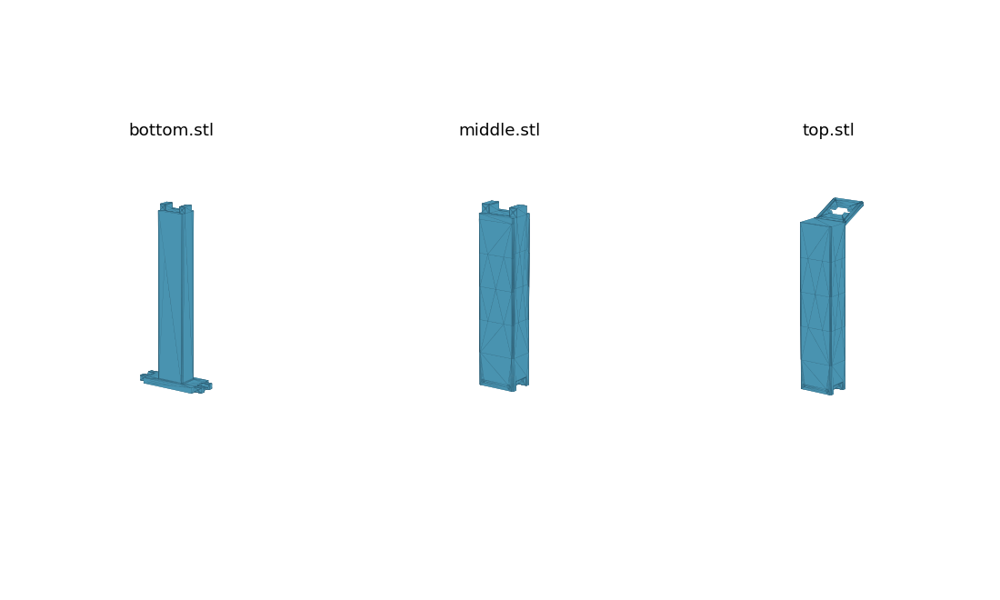
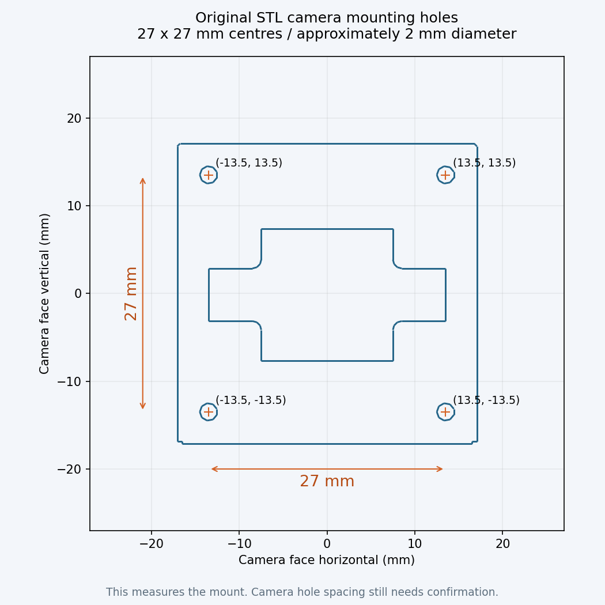

# 3D 프린팅 부품

상단 카메라 거치대와 카메라 일체형 그리퍼입니다. 아래 내용은 2026-10-03에 쓴 출력 안내문을 옮긴 것입니다.

## 출력 파일 (`stl/`)

파일 이름 끝의 `x1`은 출력 수량입니다.

| 파일 | 부품 |
|---|---|
| `stl/top_camera_mount/01_bottom_x1.stl` | 거치대 하단. 받침과 기둥이 붙은 일체형 |
| `stl/top_camera_mount/02_middle_x1.stl` | 거치대 중단. 기둥 일체형 |
| `stl/top_camera_mount/03_top_x1.stl` | 거치대 상단. 기둥과 카메라 거치대가 붙은 일체형 |
| `stl/gripper/camera_mount_gripper_x1.stl` | 카메라 마운트 일체형 고정 그리퍼 |

안내문 원본에 있던 책상 고정 클램프 STL은 이 출력 세트에 들어 있지 않습니다. 필요하면 커밋 `d0e144f`의 `_카메라마운트_작업자료/3D프린팅_STL_전달용.zip`에서 꺼낼 수 있습니다.

## 출처와 변경

- **거치대 3개:** [TheRobotStudio/SO-ARM100의 공식 STL](https://github.com/TheRobotStudio/SO-ARM100/tree/main/Optional/Overhead_Cam_Mount_32x32_UVC_Module)을 그대로 썼습니다.
- **그리퍼:** 같은 저장소의 [손목 카메라 마운트](https://github.com/TheRobotStudio/SO-ARM100/tree/main/Optional/Wrist_Cam_Mount_32x32_UVC_Module) 원본에서 겹친 면을 정리하고 카메라 구멍을 슬롯으로 바꿨습니다.
- 원본 라이선스(Apache License 2.0)는 `LICENSE-SO-ARM100.txt`에 있습니다.

## 카메라 장착

- 카메라 기판은 32×32mm를 가정했습니다. 스페이서 없이 나사로 직접 연결합니다. 안내문을 쓴 시점에는 실제 카메라와의 간섭, 나사 간격, 실물 조립을 검증하지 않은 상태였습니다.
- 거치대 상단은 공식 32×32mm 카메라 마운트 원본의 구멍을 그대로 씁니다.
- 그리퍼는 나사 간격 27×27mm를 기준으로 짧은 슬롯을 냈습니다(약 26~28mm 범위 조절이 목표). M2 볼트, 와셔, 너트로 체결합니다.

## 거치대 조립

1. 하단의 돌출 연결부에 중단을 끼우고 작은 M2 나사 4개로 고정합니다.
2. 중단의 연결부에 상단을 끼우고 M2 나사 4개로 고정합니다.
3. 상단 거치대에 렌즈를 중앙 개구부 쪽으로 향하게 놓고 M2 나사 4개로 직접 고정합니다.

기둥 접합부 나사는 원본 설명대로 Feetech 서보에 동봉된 작은 M2 나사를 기준으로 합니다. 카메라 고정 나사의 길이는 실제 기판과 거치대 두께를 보고 고릅니다. 그리퍼의 모터 고정 나사는 기존 것을 다시 씁니다.

## 출력 설정

- 단위 mm, 배율 100%. 원본의 위치가 원점에서 떨어져 있으니 슬라이서의 자동 배치를 씁니다.
- 가장 긴 치수는 하단 약 231mm, 중단 약 163mm, 상단 약 182mm입니다. 이 크기가 들어가는 출력판이 필요합니다.
- 시작값은 0.4mm 노즐, 레이어 0.16~0.20mm, 벽 5줄, 내부 채움 35%입니다.
- 그리퍼의 돌출부는 서포트를 켭니다.

## 설계 스크립트 (`design/`)

그리퍼 수정본을 만든 스크립트와 그 입력입니다. 결과물은 스크립트와 같은 폴더에 생깁니다. 이 저장소로 옮긴 뒤에는 다시 실행해 보지 않았습니다.

| 파일 | 하는 일 |
|---|---|
| `sources/Wrist_Cam_Mount_32x32_UVC_Module_SO101.stl` | 수정 전 공식 원본 |
| `inspect_wrist_source.py` | 원본을 측정하고 미리보기 그림을 만듦(형상은 바꾸지 않음) |
| `prepare_wrist_source.py` | 원본의 겹친 면을 찾아 정리 후보를 만듦 |
| `measure_camera_face.py` | 카메라가 붙는 면의 구멍 위치를 측정(`camera_face_measurements.json`) |
| `export_wrist_reference.py` | 겹친 면을 정리한 참고 메시를 내보냄(`SO101_integrated_wrist_27mm_REFERENCE_mesh_cleaned.stl`) |
| `build_camera_set_v02.py` | 참고 메시의 카메라 구멍을 슬롯으로 바꿔 최종 그리퍼를 만듦. 설계 값은 `design_parameters.json` |

실행 순서는 `prepare_wrist_source.py`, `measure_camera_face.py`, `export_wrist_reference.py`, `build_camera_set_v02.py`입니다.

이전 버전(조립식 거치대, Pi Camera V2 어댑터), 3D 미리보기 HTML, 중간 산출물은 정리하면서 지웠습니다. 커밋 `d0e144f`의 `_카메라마운트_작업자료/`에 남아 있습니다.
